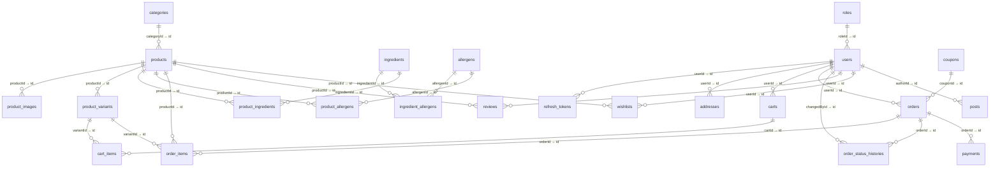

# ERD — Nini Cakes (MySQL 8 / Prisma)

> Sinh tự động từ `server/prisma/schema.prisma` bằng `node scripts/erd.mjs`. Tên bảng là `@@map` (snake_case), kiểu là kiểu vật lý MySQL tương ứng.
> Ký hiệu: `"PK"` khóa chính, `"UQ"` unique, `"def"` có giá trị mặc định.

## Sơ đồ quan hệ

## Bảng và cột

```mermaid
erDiagram
  roles {
    int id "PK,def"
    rolename name "UQ"
    varchar description
    datetime createdAt "def"
  }
  users {
    int id "PK,def"
    varchar email "UQ"
    varchar passwordHash
    varchar fullName
    varchar phone "UQ"
    varchar avatarUrl
    int roleId
    userstatus status "def"
    datetime createdAt "def"
    datetime updatedAt
    datetime deletedAt
  }
  refresh_tokens {
    int id "PK,def"
    int userId
    varchar tokenHash "UQ"
    datetime expiresAt
    datetime revokedAt
    datetime createdAt "def"
  }
  addresses {
    int id "PK,def"
    int userId
    varchar fullName
    varchar phone
    varchar addressLine
    varchar ward
    varchar district
    varchar city
    float lat
    float lng
    varchar mapsUrl
    boolean isDefault "def"
    datetime createdAt "def"
    datetime updatedAt
    datetime deletedAt
  }
  categories {
    int id "PK,def"
    varchar name
    varchar slug "UQ"
    varchar description
    int sortOrder "def"
    boolean isActive "def"
    datetime createdAt "def"
    datetime updatedAt
    datetime deletedAt
  }
  allergens {
    int id "PK,def"
    varchar name "UQ"
    varchar icon
    datetime deletedAt
  }
  ingredients {
    int id "PK,def"
    varchar name "UQ"
    varchar note
    datetime deletedAt
  }
  ingredient_allergens {
    int ingredientId
    int allergenId
  }
  products {
    int id "PK,def"
    varchar name
    varchar slug "UQ"
    varchar shortDescription
    varchar description
    int categoryId
    int price "def"
    int compareAtPrice
    boolean isActive "def"
    boolean isFeatured "def"
    boolean isSeasonal "def"
    float ratingAvg "def"
    int ratingCount "def"
    int soldCount "def"
    datetime createdAt "def"
    datetime updatedAt
    datetime deletedAt
  }
  product_images {
    int id "PK,def"
    int productId
    varchar url
    varchar alt
    boolean isPrimary "def"
    int sortOrder "def"
  }
  product_variants {
    int id "PK,def"
    int productId
    varchar name
    varchar flavor
    int price
    int stock "def"
    varchar sku "UQ"
    boolean isActive "def"
    int soldCount "def"
    datetime createdAt "def"
    datetime updatedAt
  }
  product_ingredients {
    int productId
    int ingredientId
    varchar quantity
  }
  product_allergens {
    int productId
    int allergenId
  }
  carts {
    int id "PK,def"
    varchar token "UQ"
    int userId "UQ"
    datetime createdAt "def"
    datetime updatedAt
  }
  cart_items {
    int id "PK,def"
    int cartId
    int variantId
    int quantity "def"
    int unitPrice
    json options
    datetime createdAt "def"
    datetime updatedAt
  }
  orders {
    int id "PK,def"
    varchar code "UQ"
    int userId
    orderstatus status "def"
    deliverytype deliveryType
    datetime deliveryDate
    varchar timeSlot
    varchar recipientName
    varchar recipientPhone
    varchar addressLine
    varchar ward
    varchar district
    varchar city
    float lat
    float lng
    varchar mapsUrl
    varchar note
    int subtotal
    int discount "def"
    int shippingFee "def"
    int total
    int couponId
    varchar couponCode
    paymentmethodtype paymentMethod
    paymentstatustype paymentStatus "def"
    varchar cancelReason
    datetime createdAt "def"
    datetime updatedAt
    datetime deletedAt
  }
  order_items {
    int id "PK,def"
    int orderId
    int productId
    int variantId
    varchar name
    varchar variantName
    varchar imageUrl
    int unitPrice
    int quantity
    int lineTotal
    json options
  }
  order_status_histories {
    int id "PK,def"
    int orderId
    varchar fromStatus
    varchar toStatus
    varchar note
    int changedById
    datetime createdAt "def"
  }
  payments {
    int id "PK,def"
    int orderId
    paymentmethodtype method
    paymentstatustype status "def"
    int amount
    varchar reference
    json providerMeta
    datetime paidAt
    datetime createdAt "def"
    datetime updatedAt
  }
  coupons {
    int id "PK,def"
    varchar code "UQ"
    varchar description
    coupontype type
    int value
    int minSubtotal "def"
    int maxDiscount
    int maxUses
    int usedCount "def"
    datetime startsAt
    datetime endsAt
    boolean isActive "def"
    datetime createdAt "def"
    datetime updatedAt
    datetime deletedAt
  }
  reviews {
    int id "PK,def"
    int productId
    int userId
    int orderId
    int rating
    varchar comment
    varchar imageUrl
    varchar reply
    datetime repliedAt
    boolean isApproved "def"
    boolean isHidden "def"
    datetime createdAt "def"
    datetime updatedAt
    datetime deletedAt "UQ"
  }
  wishlists {
    int id "PK,def"
    int userId
    int productId
    datetime createdAt "UQ,def"
  }
  banners {
    int id "PK,def"
    varchar title
    varchar subtitle
    varchar imageUrl
    varchar linkUrl
    int sortOrder "def"
    boolean isActive "def"
    datetime createdAt "def"
    datetime updatedAt
  }
  posts {
    int id "PK,def"
    varchar title
    varchar slug "UQ"
    varchar excerpt
    varchar content
    varchar coverImageUrl
    int authorId
    posttype type "def"
    boolean isPublished "def"
    datetime publishedAt
    datetime createdAt "def"
    datetime updatedAt
  }
  store_settings {
    int id "PK,def"
    varchar name "def"
    varchar slogan
    varchar address "def"
    varchar phone "def"
    varchar email "def"
    varchar openingHours "def"
    varchar facebook
    varchar instagram
    varchar zalo
    varchar bankName "def"
    varchar bankAccountName "def"
    varchar bankAccountNumber "def"
    int shippingFeeVnd "def"
    int freeShippingMinVnd "def"
    datetime updatedAt
  }
  messages {
    int id "PK,def"
    varchar name
    varchar email
    varchar phone
    varchar subject
    varchar content
    varchar imageUrl
    boolean isRead "def"
    datetime createdAt "def"
  }
  subscribers {
    int id "PK,def"
    varchar email "UQ"
    boolean isActive "def"
    datetime subscribedAt "def"
  }
```

## Enum (Prisma → MySQL)

- RoleName: ADMIN | STAFF | CUSTOMER
- UserStatus: ACTIVE | BLOCKED
- OrderStatus: PENDING | CONFIRMED | PREPARING | READY | SHIPPED | COMPLETED | CANCELLED
- DeliveryType: DELIVERY | PICKUP
- PaymentMethodType: COD | BANK_TRANSFER
- PaymentStatusType: UNPAID | PAID | REFUNDED
- CouponType: PERCENT | AMOUNT
- PostType: STORY | POLICY | FAQ

## Khóa và chỉ mục phụ

- `users`: [roleId]; [createdAt]
- `refresh_tokens`: [userId]
- `addresses`: [userId]
- `ingredient_allergens`: [allergenId]
- `products`: [categoryId]; [isActive]; [isFeatured]; [isSeasonal]; [createdAt]
- `product_images`: [productId]
- `product_variants`: [productId]; [productId, isActive]
- `product_ingredients`: [ingredientId]
- `product_allergens`: [allergenId]
- `cart_items`: [cartId]
- `orders`: [status]; [userId]; [deliveryDate]; [createdAt]
- `order_items`: [orderId]; [productId]
- `order_status_histories`: [orderId]
- `payments`: [orderId]
- `reviews`: [productId, userId]; [productId]; [isApproved]
- `wishlists`: [userId, productId]
- `posts`: [isPublished]

## Xóa mềm (soft delete)

Bảng có cột `deletedAt` (khác null = đã xóa, mọi truy vấn customer đều lọc `deletedAt: null`):
- users
- addresses
- categories
- allergens
- ingredients
- products
- orders
- coupons
- reviews

Các bảng còn lại dùng `isActive`/`status` để ẩn khỏi storefront (banner, category, product, user).

## Ghi chú thiết kế

- Tiền: **mọi cột tiền là `INT`** (số nguyên VNĐ, không dùng DECIMAL/float) — `price`, `compareAtPrice`, `unitPrice`, `lineTotal`, `discountAmount`, `shippingFee`, `total`, `minSubtotal`, `maxDiscount`. Cách này tránh lỗi làm tròn và khớp với cách hiển thị `formatVND`.
- `order_items` lưu **snapshot** `name`, `unitPrice`, `imageUrl`, `options` (JSON) để lịch sử không đổi khi sản phẩm bị sửa.
- `orders` lưu snapshot địa chỉ (`receiverName`, `receiverPhone`, `addressLine`, `ward`, `district`, `city`, `note`) + `deliverySlot`.
- `order_status_histories` ghi mọi lần đổi trạng thái (kèm `changedById`) — dùng cho trang theo dõi đơn và audit.
- `refresh_tokens` lưu **hash** token, gắn `userId` + `expiresAt` + `revokedAt` để xoay vòng (rotation) và thu hồi khi logout.
- `carts` liên kết theo `token` (khách vãng lai) hoặc `userId` (đã đăng nhập); khi đăng nhập thì gộp giỏ.
- `ingredients` ↔ `allergens` qua `ingredient_allergens`; `products` ↔ `allergens` qua `product_allergens` (đệ quy từ nguyên liệu khi lưu sản phẩm).
- Mối `payments` → `orders` và `refresh_tokens` → `users` là ON DELETE Cascade; `order_items` → `products` là SetNull nên lịch sử đơn còn nguyên sau khi ẩn sản phẩm.
